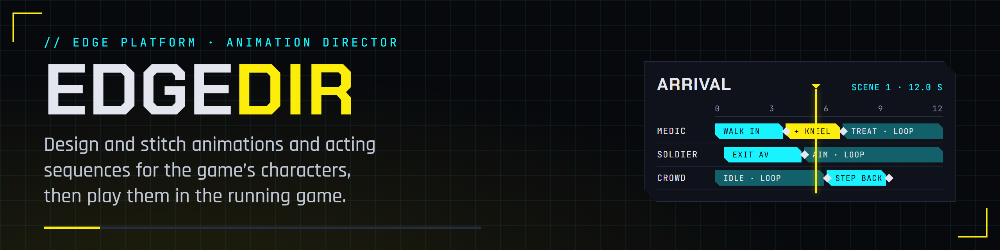

<p align="center">
  
</p>

<p align="center">
  <a href="https://edgemodders.github.io/EDGEdir/"></a>
  
  
  
  <a href="LICENSE"></a>
</p>

A director's tool for Cyberpunk 2077, as a VS Code extension in the EDGE family: design and stitch animations and acting sequences for the game's characters (NPCs), and play them on characters in the running game.

**[User manual (wiki)](https://edgemodders.ai/wiki/edgedir/)** &middot; **[Docs](https://edgemodders.github.io/EDGEdir/)** &middot; [Changelog](CHANGELOG.md) &middot; [Tests](docs/testing.md)

> [!NOTE]
> **Status: D6b Audio, 2026-11-26. Nothing is released yet.** The design is agreed ([docs/design.md](docs/design.md)). Built, and passed in VS Code in hand tests run by script: the scene editor (a timeline of tracks and clips for `.edgedir` files), the Desk, the actor picker (the game's characters, and V), the Animations view (the game's animations, with search), real animations as clips on the lanes, the 3D preview (each actor's body playing the clip under the playhead), transitions, sequences, sets (a scene made on an EDGEbuilder scene), pins (named places in the world), a weather track, and **Play in Game**. EDGE Director, EDGEdir's app in the game (its own download on each release), opens, plays and adjusts a scene there: it ran in the game for the first time on 2026-11-20, where a scene with two actors played through on time; the rest of its in-game tests have not run. The newest part, audio tracks (sound files with a waveform, and the game's own sounds by name), is built and has not been run in VS Code or in the game. What is open before a first release is in [docs/testing.md](docs/testing.md).

## Repo layout

| Folder | What |
|---|---|
| `src/` | The extension: `extension.ts` (the views), `views.ts` (their ids) |
| `test/` | Unit tests, `npm test` |
| `docs/` | The docs site, published at https://edgemodders.github.io/EDGEdir/ |
| `nexus/` | The Nexus Mods page's source and upload settings |
| `tools/` | `brand/` renders the banner, icon and badges; `release-notes.mjs` and `nexus-zip.mjs` serve the Release workflow; `release/readme-check.mjs` is shared with the other EDGE repos |

## Build

```powershell
npm install
npm run typecheck
npm run build
npm test
```

Press F5 in VS Code to run it. More in [Dev setup](docs/dev-setup.md).

| You need | Why |
|---|---|
| Windows 10 or 11, Cyberpunk 2077 on PC | The game whose characters EDGEdir directs |
| VS Code 1.90 or later | EDGEdir is a VS Code extension |

Not affiliated with CD Projekt RED.
